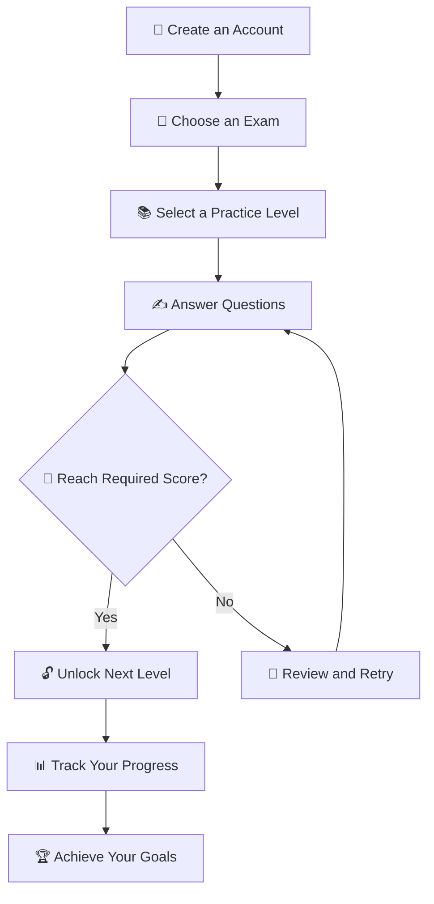

 

<!-- Animated Header -->

  <b>An AI-powered competitive exam preparation platform built to help students learn, practice, and improve.</b>

  
  
  

---

## ✨ About the Project

**Study at Bangalore** is a modern learning platform designed for students preparing for competitive examinations. It brings practice questions, mock exams, performance tracking, and AI-assisted learning into one place.

Our goal is simple: **make exam preparation smarter, more accessible, and more engaging.**

## 🎯 Exams & Preparation

| 🎓 Examination | 📚 Preparation |
|:---:|:---|
| KCET | Engineering and state entrance practice |
| NEET UG | Medical entrance preparation |
| JEE Main & Advanced | Engineering entrance practice |
| COMEDK | Undergraduate entrance preparation |
| UPSC | Civil services preparation |
| Karnataka Government Exams | Competitive exam practice |
| Scholarship & Aptitude Exams | Concept building and assessment |

## 🚀 Key Features

<table>
<tr>
<td width="50%">

### 🧠 Smart Practice
- Topic-based question practice
- Easy → Medium → Hard → Expert progression
- Level unlocks based on performance
- Retry and improve your score

</td>
<td width="50%">

### 🤖 AI Learning Assistant
- AI-assisted hints
- Guided problem-solving
- Learn concepts without immediately revealing answers
- Support for independent learning

</td>
</tr>
<tr>
<td width="50%">

### ⏱️ Exam Simulation
- Timed mock tests
- Question navigation palette
- Mark questions for review
- Exam-style submission and scoring

</td>
<td width="50%">

### 📊 Progress Dashboard
- Track practice performance
- Review scores and accuracy
- Daily streak tracking
- Leaderboards and achievements

</td>
</tr>
<tr>
<td width="50%">

### 🏆 Learning Achievements
- Mastery-based milestones
- Completion certificates
- Personal progress tracking
- Motivation to keep learning

</td>
<td width="50%">

### 📱 Modern Experience
- Responsive interface
- Mobile and desktop support
- Clean, interactive design
- Light and dark themes

</td>
</tr>
</table>

## 🛠️ Technology Stack

> Update this section to match the technologies actually used in your repository.

## 🧩 How It Works

## 🌟 Our Mission

We believe every student deserves access to a structured, engaging, and effective preparation experience.

**Practice consistently. Understand deeply. Improve every day.**

## 🌐 Explore the Platform

  

⭐ If you find this project useful, consider giving the repository a star!

---

**Built with ❤️ to make learning better.**

Study at Bangalore · Learn Smarter · Aim Higher

